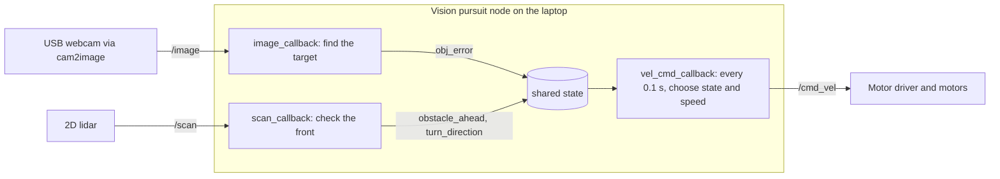
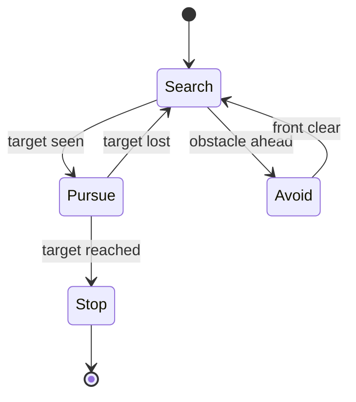

# Architecture

> **Credit:** this project runs on the [TortoiseBot](https://github.com/rigbetellabs/tortoisebot) by [RigBetel Labs](https://rigbetellabs.com). The robot, its assembly guide and the bring-up software are theirs. This page documents our own build and software on top of it.
How the robot's software fits together.

## Overview

One ROS 2 node does the whole job, and it runs on a laptop connected to the robot. Two sensor callbacks keep a small shared state up to date, and a timer reads that state ten times a second to decide how the robot moves.

Keeping the decision in one place means the sensors never fight over the motors. The callbacks only report what they see, and the timer is the only thing that publishes velocity commands.

## The three parts of the node

| Part | Runs | What it does |
|---|---|---|
| `image_callback` | every camera frame | Keeps only pixels near the target color (HSV), removes noise, finds the biggest blob, calculates its centroid using image moments, and measures how far that centroid is from the middle of the image (`obj_error`). Tiny blobs are ignored. |
| `scan_callback` | every lidar scan | Splits the scan into front, left and right sectors, cleans the readings, and sets `obstacle_ahead` and `turn_direction`. |
| `vel_cmd_callback` | every 0.1 s | Reads the shared state, picks what to do, and publishes the speed and turn command. |

## Topics

| Topic | Type | Direction | Used for |
|---|---|---|---|
| `/image` | Image | Pi to node | Frames from `cam2image` |
| `/scan` | LaserScan | Pi to node | Distance readings (best-effort QoS) |
| `/cmd_vel` | Twist | node to Pi | Forward speed and turn rate |

## Deciding what to do

The robot looks at two things: **can it see the target?** and **is something close in front?**

| Target seen | Something in front | State | What the robot does |
|---|---|---|---|
| No | No | **Search** | Drives forward at a steady speed |
| No | Yes | **Avoid** | Creeps forward slowly while turning away from the obstacle |
| Yes | No | **Pursue** | Steers toward the target and drives toward it |
| Yes | Yes | **Stop** | The thing in front is the target itself, so it has been reached and the robot stops |

An obstacle only triggers avoidance when the target isn't in view. Once the target is in view, whatever is close in front is the target, so the robot stops instead of avoiding it. On shutdown (Ctrl+C), the node also publishes a zero velocity so the robot never keeps driving.

## Design decisions

**Hysteresis on obstacles.** Something is detected when the front is closer than 0.35 m, but it is only considered gone once the front is farther than 0.5 m. The gap stops the robot from flipping between states when it is right at the limit.

**Sticking to one turning direction.** When a new obstacle appears, the robot picks the side with more free space and keeps that direction until the front is clear. If both sides are nearly equal, it keeps its previous direction. Together these stop the left-right oscillation we saw at walls ([challenge 8](challenges.md#8-obstacle-avoider-oscillating-at-walls)).

**Sectors defined by angle.** The front sector is +-20 degrees, and the side sectors are centered 60 degrees off the front and span +-35 degrees. The code converts these angles into readings using the scan's own resolution, so it still works if the lidar's resolution or scan direction changes.

**Cleaning the lidar data.** Invalid readings (`nan` or zero) are skipped, and `inf` (nothing detected) is treated as maximum range, so open space can't hide a nearby obstacle.

**Proportional steering.** The turn rate is proportional to how far the target is from the image center, with a dead zone around the center and a cap on turn speed, so the robot doesn't wobble when the target is nearly centered.

## Settings we tune

| Setting | Value | Meaning |
|---|---|---|
| `stop_distance` | 0.35 m | Something in front is detected below this |
| `clear_distance` | 0.5 m | Front is clear above this |
| `kpa` | 0.001 | Steering strength per pixel of error |
| `center_zone` | 100 px | No steering inside this |
| `max_turn_speed` | 0.8 rad/s | Steering limit |
| `pursue_speed` | 0.2 m/s | Speed when chasing |
| `search_speed` | 0.3 m/s | Speed when no target |

These came from trial and error, see [challenge 9](challenges.md#9-obstacle-avoider-speeds).

## Where it runs

The robot and the laptop talk over Wi-Fi, so both must be on the same network and ROS domain.

- **On the Raspberry Pi (over SSH):** the lidar bring-up and the camera feed.
- **On the laptop:** our vision pursuit node. It subscribes to `/image` and `/scan` from the Pi, shows the camera view with the detected target outlined, and publishes `/cmd_vel` back to the robot.

Because camera frames travel over the network, keeping them small helps, which is part of the fix in [challenge 13](challenges.md#13-camera-lag-and-late-reactions). The same logic was first tested in Gazebo Ignition and RViz2, then moved to the real robot. See the [hardware build](hardware-build.md).
