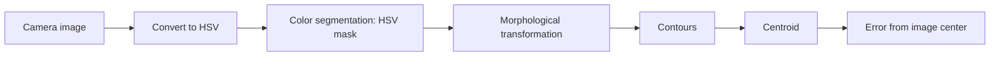

# OpenCV: Our Pipeline

This page describes the pipeline we use to find the colored target in the camera image, and why we chose each step. The code is in [src/03_simulation/color_detector.py](../src/03_simulation/color_detector.py) and in the final vision pursuit package.



## Step 1: Convert the image to HSV

As soon as an image of the environment arrives, we convert it from BGR to HSV.

**Why:** the same color can look very different under different lighting or in shadow. In BGR, those changes alter the values of every channel, so pixels of the same object can end up with drastically different numbers. In HSV the hue stays almost the same, and mostly the saturation and value change. That lets a single hue range find the target across varying lighting.

```python
frame = self.bridge.imgmsg_to_cv2(msg, desired_encoding='bgr8')
hsv = cv2.cvtColor(frame, cv2.COLOR_BGR2HSV)
```

`cv_bridge` first converts the ROS image message into an OpenCV image.

## Step 2: Color segmentation

Next, we apply an HSV mask.

**Why:** segmentation makes the robot focus only on the target color and ignore everything else in the scene.

**How:** we define a range of HSV values for the target. Every pixel inside the range becomes 255 (white) and every pixel outside becomes 0 (black), which gives a binary image.

```python
mask = cv2.inRange(hsv, self.lower_hsv, self.upper_hsv)
```

The range is built around the hue of the target color:

```python
lower = np.array([max(hue - 10, 0), 50, 50])
upper = np.array([min(hue + 10, 180), 255, 255])
```

That is a hue window of 10 either side of the target, with a minimum saturation and value of 50 to ignore washed-out and very dark pixels.

## Step 3: Morphological transformations

The binary image still contains noise, such as stray white pixels. We clean it up before looking for contours, using morphological opening (erosion followed by dilation) with a 5x5 kernel.

```python
kernel = np.ones((5, 5), np.uint8)
mask = cv2.morphologyEx(mask, cv2.MORPH_OPEN, kernel)
```

**Why not simply blur?** Blurring just smooths over the image, so the noise is softened instead of removed and the edges of the target get fuzzy. Morphological opening removes the small specks and leaves the target region clean and well defined.

## Step 4: Contours

We then find the contours in the cleaned mask.

**Why:** contours identify the shape of the object and separate it from the background. If several regions are found, we take the one with the largest area, and we ignore anything under a minimum size so noise can never be mistaken for the target.

```python
contours, _ = cv2.findContours(mask, cv2.RETR_EXTERNAL, cv2.CHAIN_APPROX_SIMPLE)
biggest = max(contours, key=cv2.contourArea, default=None)
```

## Step 5: Centroid

From the contour we calculate the centroid using image moments.

**Why:** it is far easier for the robot to follow one single coordinate than a whole body.

```python
M = cv2.moments(biggest)
if M["m00"] != 0:
    cx = int(M["m10"] / M["m00"])
    cy = int(M["m01"] / M["m00"])
```

`m00` is the area of the contour, and `m10` and `m01` are the weighted sums of the x and y coordinates, so dividing gives the center of mass.

## From centroid to steering

The horizontal distance between the centroid and the middle of the image is the error that drives the robot:

```python
obj_error = cx - width // 2    # negative = target is left, positive = right
```

The steering turns in proportion to this error. If nothing big enough is found, the error is set to `None`, which tells the robot's state machine that the target is not in view. See [architecture.md](architecture.md).

For debugging, we draw a rectangle and a dot on the detected target and show the frame with `cv2.imshow`. It made wrong detections obvious and was the fastest way to tune the color range.

## Our settings

| Setting | Value | Purpose |
|---|---|---|
| Target color | green (BGR 0, 255, 0) | The color the robot pursues |
| Hue window | target hue +-10 | Range of colors accepted |
| Minimum saturation and value | 50 | Rejects washed-out and dark pixels |
| Morphology kernel | 5x5 | Size of the noise-removal window |
| Minimum target area | 150 px | Smaller blobs are ignored as noise |

## Practical notes

- The HSV range has to be tuned with the real camera and real lighting, because values that work in simulation rarely carry over unchanged.
- Lowering the camera to 320x240 at 20 frames per second keeps the Raspberry Pi responsive.

